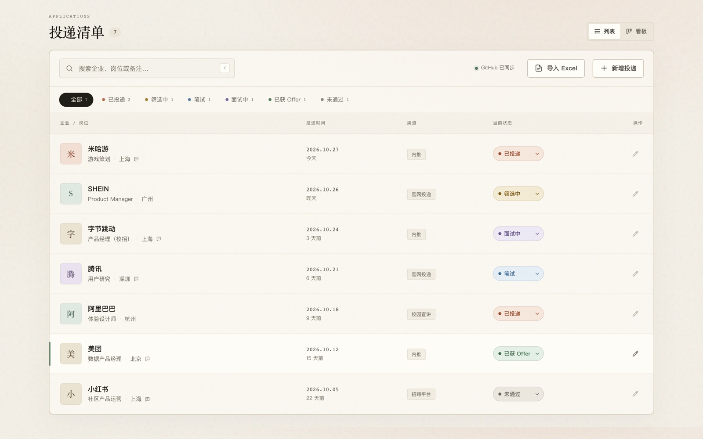
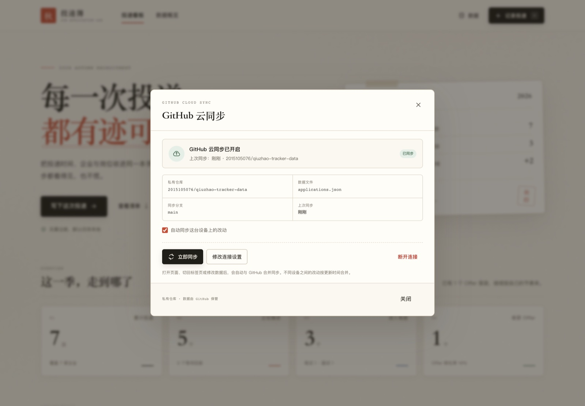
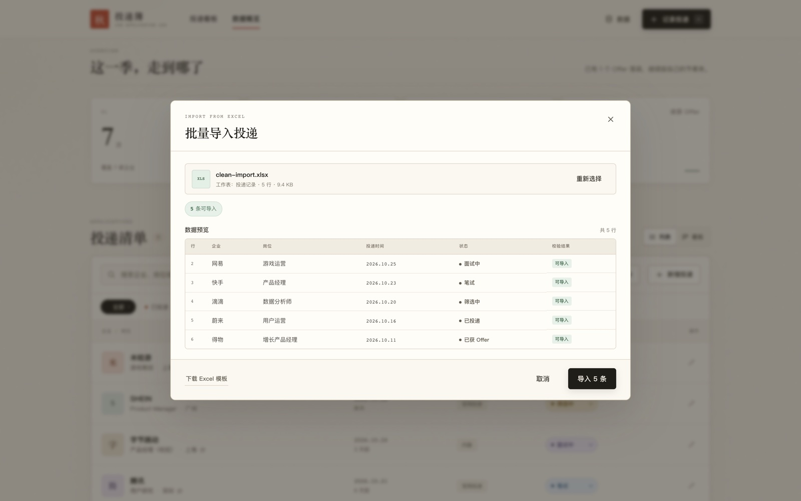

# 投递簿 · 秋招投递手帐

一本安静、清晰的秋招投递记录本。把投递时间、企业、岗位和进度收进同一个页面，支持 Excel 批量导入与 GitHub 私有云同步，让每一次投递都有迹可循，也能在手机和电脑之间共享进度。

**在线使用：** https://2015105076.github.io/qiuzhao-tracker/

[](https://2015105076.github.io/qiuzhao-tracker/)

## 功能

- **记录投递**：企业、岗位、投递时间、当前状态四项必填，支持补充投递渠道、工作城市和备注。
- **Excel 批量导入**：上传编辑好的 Excel 文件，自动识别字段、校验数据、预览后批量写入；支持跳过重复记录，并提供带状态下拉的模板与填写说明。
- **状态管理**：已投递、筛选中、笔试、面试中、已获 Offer、未通过，可在列表中直接切换。
- **列表 / 看板双视图**：列表适合快速查找，看板支持拖拽卡片更新状态。
- **筛选与搜索**：按状态筛选，按企业、岗位、城市、渠道或备注搜索。
- **数据概览**：累计投递、正在推进、进入笔面、Offer 数量与本季推进率。
- **本地优先**：默认自动保存在浏览器 `localStorage`，无需注册。
- **GitHub 云同步**：可选连接自己的私有 GitHub 仓库，在手机、电脑等不同设备之间同步记录；数据不会进入公开站点。
- **数据备份**：支持导出 CSV 表格、导出/导入 JSON 备份。
- **响应式布局**：桌面端、平板和手机均可使用。
- **快捷键**：按 `N` 新增投递，按 `/` 聚焦搜索框。

## GitHub 云同步（跨设备）

网站是纯静态页面，默认数据只存在当前浏览器。要实现跨设备同步，项目使用**你自己的私有 GitHub 仓库**作为数据存储，并已经准备好了一个私有数据仓库：

**https://github.com/2015105076/qiuzhao-tracker-data**

这台仓库只保存 `applications.json`，不会发布成网页，也不会进入公开的站点仓库。



### 第一次连接

1. 打开 [GitHub Token 设置](https://github.com/settings/personal-access-tokens/new)，创建一个 **Fine-grained personal access token**。
2. **Resource owner** 选择你的 GitHub 账号；**Repository access** 选择 **Only select repositories**，只勾选 `2015105076/qiuzhao-tracker-data`。
3. **Permissions → Repository permissions → Contents** 设置为 **Read and write**（Metadata 会自动获得只读权限）。
4. 生成 Token 后回到网站，点击右上角「数据 → GitHub 云同步」，或点击投递清单上方的同步状态。
5. 粘贴 Token，点击「连接并同步」。本地已有记录会与远程记录合并。

在另一台设备上使用**同一个仓库和 Token**重复上述操作，即可看到相同的数据。

### 同步行为

- 打开页面、切回标签页、修改数据、网络恢复，以及页面保持打开时每分钟，都会尝试自动同步。
- 不同设备的改动按记录的最后更新时间合并；删除记录会留下删除标记，避免在另一台设备上“复活”。
- 如果 GitHub 上的文件被其他设备更新，提交冲突会自动重新读取、合并后重试。
- 自动同步可以关闭，关闭后仍可点击「立即同步」手动同步。
- 断开连接只清除当前设备的同步设置，不会删除 GitHub 上的数据或本地记录。

### 安全说明

- 投递数据会写入**私有仓库**；应用会拒绝连接公开仓库，避免投递信息被公开。
- Token 只保存在当前浏览器的 `localStorage`，不会写入站点代码、页面 URL 或 `applications.json`。
- 建议使用仅授权单个仓库、仅需 Contents 读写权限的 Fine-grained Token，并设置合理有效期。
- 如果 Token 遗失或不再使用，请到 GitHub 设置中撤销；撤销后可在网站上更换 Token。
- 这是基于 GitHub API 的同步，不是 GitHub OAuth 登录，因此每台设备需要配置一次 Token。

## Excel 批量导入

点击投递清单上方或右上角「数据」菜单中的「导入 Excel」，即可上传编辑好的表格。第一次使用建议先下载模板：



1. 在「投递记录」工作表中填写数据，**不要修改第一行字段名**。
2. 每行填写一条投递记录，空行会自动跳过。
3. 上传后会先显示校验预览，重复记录默认跳过，确认无误后点击「导入」。
4. 有问题的行会标红并说明原因，可以回 Excel 修正后重新上传。

支持字段：

| 字段 | 必填 | 可识别的表头写法 |
| --- | --- | --- |
| 企业 | 是 | 企业、公司、企业名称、公司名称、单位、company |
| 岗位 | 是 | 岗位、职位、投递岗位、应聘岗位、position |
| 投递时间 | 是 | 投递时间、投递日期、申请日期、日期、date |
| 状态 | 否 | 状态、投递状态、当前状态、进度、status |
| 投递渠道 | 否 | 渠道、投递渠道、来源、channel |
| 工作城市 | 否 | 城市、工作城市、地点、location |
| 备注 | 否 | 备注、说明、notes |

状态可填写：`已投递`、`筛选中`、`笔试`、`面试中`、`已获 Offer`、`未通过`。状态留空时按「已投递」导入。

投递时间推荐使用 `YYYY-MM-DD` 格式，也支持 Excel 日期单元格、`2026/10/24`、`2026年10月24日` 等写法。

文件限制：支持 `.xlsx`、`.xls`、`.csv`，单次最多 1,000 条记录，文件不超过 8 MB。重复判断依据为「企业 + 岗位 + 投递时间」，导入前可选择是否跳过重复项。

## 本地运行

项目没有构建依赖，直接打开 `index.html` 或启动一个静态服务器即可：

```bash
python3 -m http.server 8000
```

然后访问 `http://localhost:8000`。

## 部署到 GitHub Pages

仓库已包含 [`.github/workflows/deploy-pages.yml`](.github/workflows/deploy-pages.yml)。推送到 `main` 分支后，GitHub Actions 会自动发布静态站点。

首次部署时，在仓库的 **Settings → Pages → Build and deployment** 中将 Source 设为 **GitHub Actions** 即可。

跨设备数据存放在独立的私有仓库 `qiuzhao-tracker-data` 中，与公开的 Pages 站点分离；部署站点不会上传或暴露投递数据。

## 数据说明

- 默认情况下，记录只保存在当前浏览器；站点本身不包含任何个人投递数据。
- 开启 GitHub 云同步后，记录会写入你自己的私有仓库，公开的 GitHub Pages 站点仍然只有代码，没有投递数据。
- 清理浏览器网站数据会丢失本机缓存和同步 Token，但云端 JSON 仍保留；重新配置 Token 后可以拉回记录。
- CSV 使用 UTF-8 BOM 编码，可直接用 Excel 或 Numbers 打开。
- 建议保留定期导出的 JSON 备份，作为额外保险。

## 项目结构

```text
.
├── index.html                  # 页面结构
├── assets/
│   ├── styles.css              # 视觉样式与响应式布局
│   ├── app.js                  # 数据、交互、Excel 导入、GitHub 同步与本地存储
│   ├── favicon.svg
│   ├── og-cover.jpg
│   ├── preview.jpg
│   ├── import-preview.jpg      # Excel 导入界面预览
│   ├── sync-preview.jpg        # GitHub 云同步界面预览
│   ├── import-template.xlsx    # Excel 批量导入模板
│   └── vendor/                 # 按需加载的 SheetJS 及许可证
├── tools/
│   └── create_import_template.py  # 重新生成 Excel 模板
├── .github/workflows/
│   └── deploy-pages.yml        # GitHub Pages 自动部署
└── README.md
```

## 技术栈

原生 HTML、CSS 和 JavaScript，无框架、无构建步骤。Excel 解析使用按需加载的 [SheetJS Community Edition](https://sheetjs.com/)（Apache-2.0），详见 [`assets/vendor/README.md`](assets/vendor/README.md)。部署后就是一个纯静态站点。

## 第三方依赖

- [SheetJS Community Edition 0.20.3](https://sheetjs.com/)（Apache-2.0）：浏览器端 Excel 解析与模板生成，仅在导入时加载。
